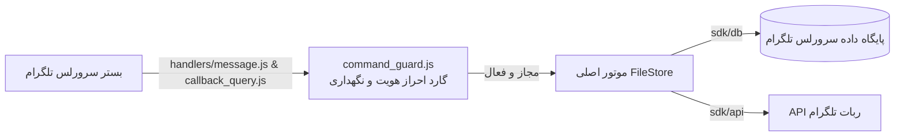

# ربات مدیریت و اشتراک‌گذاری فایل تلگرام (نسخه Telegram Serverless)

[🇬🇧 English Documentation](./README.md)

ربات سرورلس ذخیره‌سازی و اشتراک‌گذاری فایل تلگرام مبتنی بر @tgcloud/bot. نسخه **1.0.0**.

> [!TIP]
> **علاقه‌مند به نسخه کلودفلر (Cloudflare Workers + D1) هستید؟**
> می‌توانید به مخزن همکار [telegram-uploader-bot-cloudflare](https://github.com/AZiPA/telegram-uploader-bot-cloudflare) مراجعه کنید که بر پایه Cloudflare Workers و پایگاه داده D1 پیاده‌سازی شده است.

---

## بررسی اجمالی و معماری با هزینه صفر

ربات سرورلس ذخیره‌سازی و اشتراک‌گذاری فایل تلگرام مبتنی بر @tgcloud/bot. این نسخه به‌صورت ۱۰۰٪ داخل بستر سرورلس رسمی تلگرام (`@tgcloud/bot`) اجرا می‌شود و نیاز به موارد زیر را به‌طور کامل از بین می‌برد:
- **بدون نیاز به VPS یا سرور اختصاصی**
- **بدون هرگونه هزینه سرویس ابری جانبی**
- **بدون وابستگی `node_modules` در زمان اجرا** (تنها با استفاده از ماژول‌های بومی `'sdk'`، `'sdk/db'` و `'sdk/api'`)
- **بدون وابستگی به `process.env`** (تمام تنظیمات سیستم به‌صورت پویا در جدول `system_config` ذخیره می‌شوند)

فایل‌ها هرگز درون حافظه ربات دانلود یا ذخیره موقت نمی‌شوند. تحویل فایل‌ها با شناسه مستقیم `file_id` یا کپی دسته‌جمعی از کانال ذخیره‌سازی اختیاری (`copyMessages`) انجام می‌شود.



---

## قابلیت‌های کلیدی و معماری مهندسی

### قابلیت‌های اصلی مدیریت و اشتراک‌گذاری فایل
- **آپلود تکی و دسته‌ای:** امکان ارسال فایل تکی یا شروع نشست آپلود چندتایی با `/batch` و اتمام با `/done` (تا سقف ۲۵ فایل در هر بسته).
- **تحویل چندمرحله‌ای فایل‌ها (صفحه‌بندی):** ارسال فایل‌ها در دسته‌های ۱۰تایی با نمایش نوار پیشرفت و لینک مستقیم (`t.me/YourBot?start=CODE`).
- **بسته‌های زمان‌دار و یک‌بار مصرف:** تنظیم انقضای زمانی خودکار (۱، ۶، ۱۲، ۲۴، ۴۸ ساعت) و بسته‌های خودتخریب‌گر پس از دانلود کامل (`is_one_time`).
- **حفاظت با رمز عبور (PIN):** قفل‌گذاری روی بسته‌ها با پین‌کد ۱ تا ۳۲ کاراکتری، هش ایمن نمک‌دار نسخه ۲ مستقل از چرخش لینک، مجوز دسترسی ۱۵ دقیقه‌ای دانلود چندبخشی و مسدودسازی بادوام ۳۰ دقیقه‌ای پس از ۵ تلاش ناموفق.
- **چرخش زمان‌بندی‌شده پیوندها:** تغییر دوره‌ای و خودکار شناسه ۱۴ کاراکتری بسته با آنتروپی بالا در فواصل زمانی مشخص (۶، ۱۲، ۲۴، ۴۸ ساعت) به همراه به‌روزرسانی زنده دکمه پست کانال و حفظ رمز عبور.
- **مالکیت سلسله‌مراتبی انتخابی:** مدیریت اشتراکی پیش‌فرض میان ادمین‌ها به همراه امکان قفل مالکیتی (`owner_locked`) جهت جلوگیری از تغییر بسته‌های حساس توسط رده‌های پایین‌تر.
- **عضویت اجباری در کانال‌ها (Force-Join):** الزام کاربران به عضویت در حداکثر ۸ کانال (`MAX_FORCE_JOIN_CHANNELS = 8`) پیش از دریافت فایل، با بررسی موازی حداکثر ۶ کانال به‌طور همزمان.
- **پنل مدیریت تعاملی (Hub & Review):** رابط کاربری شیشه‌ای هوشمند برای ویرایش عنوان، قفل‌ها، پیش‌نمایش دریافت یا حذف انتخابی فایل‌ها (`/edit`, `/manage`, `/review`).

### ارتقاهای اخیر معماری و امنیت سیستم
1. **مصونیت کامل در برابر تزریق SQL (SQL Injection):** استفاده از Prepared Statementهای بومی Drizzle ORM در پایگاه داده سرورلس (`sdk/db`) با پارامترهای کاملاً ایمن و Type-safe جهت جلوگیری از هرگونه نفوذ و تزریق کد به پایگاه داده.
2. **جلوگیری جامع از تزریق HTML و پالایش موجودیت‌های تلگرام:** پاک‌سازی و فرار دادن کلیه ورودی‌های پویا، متون، نام فایل‌ها و داده‌های دریافتی با تابع `escapeHtml()` پیش از ارسال به تلگرام در حالت پارس HTML.
3. **معماری بومی دوزبانه (i18n) با تطابق ۱۰۰٪ کلیدها و توکن‌ها:** تفکیک ماژولار دیکشنری‌های فارسی و انگلیسی با بررسی خودکار هماهنگی کامل تمام ۲۶۵ کلید و توکن‌های متغیر `{placeholder}` بدون هیچ کلید جاافتاده یا توکن ناهماهنگ.
4. **ماشین حالت تمیز مبتنی بر نشست (FSM) + فورس ریپلای تلگرام:** جایگزینی کامل هشتگ‌های متنی قدیمی با نشست‌های پایگاه داده دارای انقضای زمانی دقیق (TTL) و بهره‌گیری از قابلیت `force_reply` تلگرام در دریافت رمز عبور، ویرایش پروفایل، افزودن ادمین و نام‌گذاری دکمه کانال‌ها.
5. **حالت نگهداری اختصاصی و سخت‌گیرانه مالک (Owner-only Maintenance Mode):** قفل آنی ربات با دستور `/maintenance` جهت قطع دسترسی کلیه کاربران و ادمین‌ها به جز مالک اصلی پیش از ورود به هسته پردازش، جهت انجام امن مهاجرت‌ها و به‌روزرسانی‌های ساختاری.
6. **کش درون‌حافظه‌ای با زمان انقضا (TTL Cache ۶۰ ثانیه‌ای):** ریزکش (Micro-caching) برای سطوح دسترسی مدیران (`getAdmins`) و پارامترهای پیکربندی پویا (`getConfig`) جهت حذف رفت‌وبرگشت‌های تکراری به پایگاه داده SQLite/D1 در هر پیام و کالبک کوئری.
7. **نگهداری اتمیک مبتنی بر مقایسه و جایگزینی (CAS):** اجرای وظایف نگهداری پس‌زمینه بهینه‌ساز (`last_maint_at`) به‌صورت ایمن از نظر همزمانی (Concurrency-safe) جهت جلوگیری از اجرای امواج تکراری و خطاهای محدودیت نرخ (Rate-limit) در ایزوله‌های موازی V8.
8. **بررسی غیرمخرب و غیرفعال عضویت در کانال‌ها (Passive Force-Join):** اعتبارسنجی عضویت صرفاً با متد `getChatMember` بدون تغییر یا ایجاد مجدد لینک دعوت، جهت جلوگیری از حذف اشتباه کانال‌ها و خطاهای محدودیت نرخ ۴۲۹ تلگرام.
9. **گاردهای پاک‌سازی با ظرفیت حافظه محدود (Bounded Memory Eviction):** هرس و پاک‌سازی خودکار نقشه‌های گلوگاه داخلی (`strikeMap`) جهت جلوگیری از مصرف بی‌رویه حافظه در چرخه حیات ایزوله‌های گرم سرورلس.

---

## ساختار مخزن

```
telegram-filestore-tgcloud/
├── tgcloud/
│   ├── schema.js               # طرح پایگاه داده ۱۱ جدولی با DSL سرورلس تلگرام
│   ├── handlers/
│   │   ├── message.js          # استثنای وضعیت صفر، گارد دسترسی و هندلر پیام‌ها
│   │   └── callback_query.js   # استثنای وضعیت صفر، گارد دسترسی و هندلر دکمه‌ها
│   └── lib/
│       ├── helpers.js          # توابع اشتراکی اصلی (sendMsg، editMsg، editMarkup، answerCq و...)
│       ├── admin/
│       │   ├── admins.js       # منطق اعطا، لغو و فهرست‌بندی نقش‌های ادمین
│       │   ├── factory_reset.js# رویه‌های اتمیک بازنشانی کارخانه و خالی‌کردن جداول
│       │   ├── helpers.js      # ابزارها و پیام‌های کمکی بخش مدیریت
│       │   ├── index.js        # توزیع‌کننده دستورات و منوهای مدیریتی
│       │   ├── maintenance.js  # فعال/غیرفعال‌سازی وضعیت نگهداری ویژه مالک
│       │   ├── members.js      # فهرست کادر مدیریت و ارتقا/تنزل مدیران و VIP
│       │   ├── members_panel.js# پنل‌ها و کیبوردهای شیشه‌ای مدیریت کارکنان
│       │   ├── owner.js        # ثبت و انتقال مالکیت اصلی (/setbotowner)
│       │   ├── profile.js      # ماشین حالت ویرایش پروفایل ربات (نام، درباره، بیو)
│       │   ├── profile_panel.js# کیبوردهای شیشه‌ای تنظیمات پروفایل ربات
│       │   ├── settings.js     # مدیریت تنظیمات سیستم (سهمیه‌ها، زمان‌ها، محافظت‌ها)
│       │   ├── settings_panel.js# پنل رابط کاربری شیشه‌ای تنظیمات سیستم
│       │   ├── sql_console.js  # کنسول تعاملی اجرای کوئری اس‌کیو‌ال برای مالک
│       │   └── stats.js        # محاسبات آماری و تحلیل دانلودها
│       ├── bundles/
│       │   ├── deletion.js     # حذف بسته و پاک‌سازی آبشاری وابستگی‌ها
│       │   ├── expiry.js       # محاسبه زمان انقضا و پاک‌سازی خودکار بسته‌ها
│       │   ├── hub_panel.js    # پنل تعاملی هاب مدیریت بسته و دکمه‌های عملیاتی
│       │   ├── index.js        # مسیریاب و نقطه ورود بخش بسته‌ها
│       │   ├── permissions.js  # گارد دسترسی و قفل مالکیتی بسته‌ها
│       │   ├── pin.js          # اعتبارسنجی پین‌کد و بررسی هش PBKDF2/SHA-256
│       │   ├── protected.js    # حفاظت با پین‌کد، هشینگ و مدیریت قفل
│       │   ├── review_panel.js # رابط کاربری بررسی و حذف انتخابی فایل‌های بسته
│       │   ├── rotation.js     # چرخش زمان‌بندی‌شده پیوندها و به‌روزرسانی پست کانال
│       │   └── setname.js      # فرآیند تعاملی تغییر نام بسته
│       ├── core/
│       │   ├── background.js   # اجرای نگهداری و پاک‌سازی بهینه پس‌زمینه
│       │   └── router.js       # مسیریاب مرکزی پیام‌ها و دکمه‌های شیشه‌ای
│       ├── filestore/
│       │   ├── delivery.js     # تحویل چندمرحله‌ای فایل‌ها (تا ۲۵ فایل) با صفحه‌بندی
│       │   ├── search.js       # جستجوی بسته‌ها بر اساس عنوان
│       │   ├── unlock.js       # اعتبارسنجی رمز عبور و مجوز دانلود
│       │   ├── upload.js       # خط لوله آپلود تکی و چندتایی (/batch)
│       │   └── voting.js       # ثبت و مدیریت آرای مثبت و منفی کاربران
│       ├── force_join/
│       │   ├── handlers.js     # هندلرهای دستورات و دکمه‌های جوین اجباری
│       │   ├── panel.js        # پنل مدیریت کانال‌های اجباری و فهرست آن‌ها
│       │   ├── service.js      # سرویس بررسی عضویت چندکاناله (تا حداکثر ۸ کانال)
│       │   └── wizards.js      # ویزاردهای افزودن کانال و برچسب دکمه
│       ├── locales/
│       │   ├── en.js           # دیکشنری محلی انگلیسی (۲۶۵ کلید)
│       │   ├── fa.js           # دیکشنری محلی فارسی (جداسازی طبق قانون ۱۴، ۲۶۵ کلید)
│       │   └── index.js        # متصل‌کننده پویا و قالب‌بندی متون محلی
│       ├── middlewares/
│       │   ├── auth.js         # گارد احراز هویت و تعیین سطوح دسترسی نقش‌ها
│       │   ├── command_guard.js# محدودکننده نرخ پیام‌ها و گارد نگهداری
│       │   ├── rate_limiter.js # محدودکننده نرخ لغزان و ثبت اخطارهای سوءاستفاده
│       │   └── roles/
│       │       ├── admin.js       # بررسی دسترسی سطح ۲ ادمین
│       │       ├── owner.js       # بررسی دسترسی سطح ۴ مالک
│       │       ├── public.js      # بررسی دسترسی کاربران عمومی و محدودیت نرخ
│       │       └── super_admin.js # بررسی دسترسی سطح ۳ ابرمدیر و کنترل دسترسی اداری
│       ├── services/
│       │   ├── log_channel.js  # سرویس ارسال لاگ‌های امنیتی و رویدادها
│       │   ├── media_config.js # پیکربندی پویا و تغییر انواع رسانه‌های مجاز
│       │   └── storage_channel.js # سرویس پشتیبان‌گیری و همگام‌سازی کانال ذخیره‌سازی
│       └── shared/
│           ├── buttons.js      # سازنده کیبوردهای شیشه‌ای تلگرام
│           ├── config.js       # کش درون حافظه‌ای تنظیمات سیستم (system_config)
│           ├── constants.js    # مقادیر پیش‌فرض، سقف‌ها و زمان‌های انقضا
│           ├── crypto.js       # تولید شناسه‌های امن، هشینگ و توابع Web Crypto
│           ├── emojis.js       # رندر اموجی‌های سفارشی و مدارشکن خودکار
│           ├── formatters.js   # پاک‌سازی و فرار دادن HTML و قالب‌بندی متون
│           ├── sessions.js     # مدیریت ماشین حالت نشست‌ها و درخواست‌های ورودی
│           └── telegram.js     # توابع سطح پایین تعامل با وب‌سرویس تلگرام
├── scripts/
│   └── patch-snapshot.mjs      # پچر سازگاری اسنپ‌شات CLI پس از نصب
├── .github/
│   └── workflows/
│       └── deploy.yml          # استقرار خودکار GitHub Actions با @tgcloud/cli
└── package.json
```

---

## طرح پایگاه داده (Database Schema)

طرح پایگاه داده در فایل `tgcloud/schema.js` با استفاده از ORM DSL سرورلس تلگرام تعریف شده است:

| جدول | توضیحات |
|---|---|
| `bundles` | اطلاعات بسته‌ها، آرایه JSON فایل‌ها (تا ۲۵ مورد)، شناسه سازنده، زمان انقضا، پرچم یک‌بار مصرف، هش SHA-256 رمز عبور و تنظیمات چرخش خودکار لینک. |
| `admin_sessions` | مدیریت نشست‌های تعاملی ادمین‌ها (ویرایش پروفایل، برچسب کانال، افزودن ادمین، تنظیم رمز بسته) با طول عمر ۳۰۰ ثانیه و قابلیت لغو با دستور (Command Breakout). |
| `user_sessions` | مدیریت نشست‌های تعاملی کاربران نهایی (مانند بازگشایی بسته‌های رمزدار و مجوز ۱۵ دقیقه‌ای دانلود چندبخشی) با ردیابی دفعات تلاش (حداکثر ۳ بار) و مقابله با حملات Brute-Force. |
| `system_config` | جدول ذخیره تنظیمات کلید-مقدار سیستم بدون نیاز به متغیر محیطی (`owner_id`، کانال ذخیره‌سازی، کانال لاگ، وضعیت نگهداری، سهمیه روزانه و زبان). |
| `admins` | فهرست مدیران سیستم و نقش‌های سطح‌بندی‌شده (`admin` و `super_admin`). |
| `vips` | فهرست کاربران ویژه با زمان انقضا و معافیت از محدودیت سهمیه و عضویت اجباری. |
| `force_channels` | کانال‌های عضویت اجباری، لینک‌های دعوت، متن دکمه شیشه‌ای و سقف عضویت هدف. |
| `user_quotas` | کنترل نرخ درخواست‌ها، سهمیه دانلود روزانه، ردیابی اخطارهای پایدار (قفل ۳۰ دقیقه‌ای پس از ۵ خطا) و زمان رفع مسدودیت کاربران. |
| `user_downloads` | تاریخچه و لاگ دانلود کاربران به تفکیک شناسه بسته و تاریخ جهت ممیزی و آمار. |
| `bundle_votes` | ثبت بازخوردها و آرای کاربران (پسندیدن/نپسندیدن) برای هر بسته. |
| `deletion_queue` | صف پیام‌های موقت و نیازمند حذف خودکار در دوره‌های نگهداری پس‌زمینه. |

---

## نحوه استقرار و پیکربندی

### فرآیند راه‌اندازی در وضعیت صفر (Zero-State Bootstrap)

نیازی به تعریف ثابت شناسه عددی مالک (`OWNER_ID`) در متغیرهای محیطی یا کدها **نیست**:
1. **راه‌اندازی اولیه (وضعیت صفر):** در اولین استقرار که پایگاه داده خالی است و مالکی در `system_config` ثبت نشده، ربات به‌طور خودکار در حالت **Zero-State** قرار می‌گیرد.
2. **احراز هویت تعاملی مالک:** در این وضعیت، تمامی دستورات عمومی و پردازش فایل‌ها مسدود بوده و تنها دستور `/setbotowner` پذیرفته می‌شود. مالک اصلی در چت خصوصی این دستور را ارسال کرده و بلافاصله به‌عنوان مالک ثبت می‌شود.
3. **ثبت دائمی و قفل امنیتی:** پس از ثبت شناسه در جدول تنظیمات، ربات از وضعیت صفر خارج شده و مالک می‌تواند کانال‌ها را تنظیم، ادمین‌ها را اضافه و سیستم را پیکربندی کند.

### پیکربندی بدون متغیر محیطی (Zero-Env)

محیط سرورلس تلگرام از `process.env` استفاده نمی‌کند. کلیه تنظیمات درون جدول `system_config` نگهداری شده و با دستورات ربات مدیریت می‌شوند:
- تنظیم کانال ذخیره‌سازی: `/setstoragechannel <-100...|off|clear>`
- تنظیم کانال لاگ‌های امنیتی: `/setlogchannel <-100...|off|clear>`
- تغییر وضعیت نگهداری سیستم: `/maintenance`
- تغییر زبان پیش‌فرض: `/setlang`
- تنظیمات سهمیه و زمان‌ها: `/settings`

نام کاربری ربات نیز به‌صورت خودکار در زمان اجرا از متد `api.getMe()` دریافت می‌گردد.

### روش‌های استقرار

#### روش اول: پایپ‌لاین خودکار GitHub Actions (توصیه‌شده)

فرآیند استقرار به‌صورت کاملاً خودکار با `@tgcloud/cli` از طریق GitHub Actions (`.github/workflows/deploy.yml`) انجام می‌شود:
1. مخزن را فورک کرده یا در حساب گیت‌هاب خود قرار دهید.
2. در بخش تنظیمات مخزن (**Settings > Secrets and variables > Actions**) سکرت زیر را ثبت کنید:
   - `TGCLOUD_TOKEN`: تنها توکن دسترسی مورد نیاز CLI سرورلس تلگرام (محدود به مراحل اجرایی CLI در `.github/workflows/deploy.yml`).
3. با ارسال هر تغییر به شاخه `main`، ورک‌فلو به‌صورت خودکار مراحل زیر را اجرا می‌کند:
   - نصب CLI سرورلس (`@tgcloud/cli`) با دستور `npm install --no-audit --no-fund`.
   - دریافت وضعیت فضای ابری (`tgcloud fetch`).
   - ارسال کدهای به‌روزرسانی‌شده (`tgcloud push`).
   - اعمال مهاجرت‌های امن پایگاه داده بدون حذف داده‌ها (`tgcloud migrate --safe`).
   - هماهنگ‌سازی و ثبت وب‌هوک تلگرام (`tgcloud webhook sync`).

#### روش دوم: استقرار دستی با `@tgcloud/cli`

1. نصب وابستگی‌ها:
   ```bash
   npm install
   ```

2. استقرار مستقیم با دستورات CLI:
   ```bash
   npx @tgcloud/cli push
   npx @tgcloud/cli migrate --safe
   npx @tgcloud/cli webhook sync
   ```

---

## دستورات و نقش‌های کاربری

### سلسله‌مراتب نقش‌ها
- **مالک اصلی (Owner - سطح ۴):** دسترسی تام به تمامی بخش‌ها، معافیت از حالت نگهداری، اجرای `/setbotowner` و `/factoryreset`، آزادسازی بسته‌های قفل‌شده مالکیتی.
- **مدیر ارشد (SuperAdmin - سطح ۳):** دسترسی مدیریتی گسترده، امکان عزل و نصب ادمین‌های عادی و مدیریت بسته‌های عمومی.
- **مدیر (Admin - سطح ۲):** ایجاد و مدیریت بسته‌ها، تنظیم کانال‌های جوین اجباری، اعمال تنظیمات ربات و مشاهده آمار.
- **کاربر ویژه (VIP - سطح ۱):** دانلود نامحدود و معافیت کامل از بررسی عضویت در کانال‌های اجباری.
- **کاربر عادی (User - سطح ۰):** دسترسی استاندارد با سهمیه دانلود روزانه و الزام به عضویت در کانال‌های اجباری.

### دستورات کلیدی
- `/start` یا `/start <code>`: دریافت بسته‌های فایل یا شروع کار با ربات.
- `/setbotowner`: ثبت اولیه مالک در وضعیت صفر یا انتقال مالکیت توسط مالک فعلی.
- `/setstoragechannel <-100...|off|clear>`: تنظیم یا لغو کانال اختصاصی پشتیبان‌گیری دائمی فایل‌ها.
- `/setlogchannel <-100...|off|clear>`: تنظیم یا لغو کانال ارسال هشدارهای امنیتی و رخدادها.
- `/batch`: شروع نشست ارسال گروهی فایل‌ها (ارسال تا ۲۵ فایل و اتمام با `/done`).
- `/manage <code>` یا `/edit <code>`: باز کردن هاب تعاملی مدیریت بسته.
- `/review <code>`: مرور فایل‌های بسته با امکان حذف تک‌تک آیتم‌ها.
- `/channels`: مدیریت کانال‌های عضویت اجباری.
- `/admins`: مدیریت لیست مدیران و سطوح دسترسی.
- `/vips`: مدیریت لیست کاربران ویژه و اشتراک‌ها.
- `/stats`: آمار کلی سیستم و تحلیل دانلودها.
- `/settings`: تنظیمات سهمیه دانلود، زمان انقضا و محافظت‌های پیش‌فرض.
- `/maintenance`: فعال/غیرفعال‌سازی حالت نگهداری ویژه مالک.
- `/botprofile`: ویرایش مستقیم نام، توضیحات و معرفی کوتاه ربات.
- `/setlang`: تغییر زبان رابط کاربری (`English` یا `فارسی`).

---

## مجوز

مجوز MPL-2.0.
