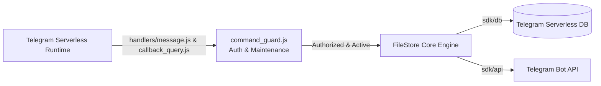

# Telegram FileStore Bot (Telegram Serverless Edition)

[🇮🇷 مطالعه راهنمای فارسی (Persian Documentation)](./README.fa.md)

Serverless Telegram file storage and sharing bot, powered by @tgcloud/bot. Version **1.0.0**.

> [!TIP]
> **Prefer Cloudflare Workers + D1?**
> Check out the sister repository: [telegram-uploader-bot-cloudflare](https://github.com/AZiPA/telegram-uploader-bot-cloudflare) for the Cloudflare Workers + D1 SQL database edition.

---

## Overview & Zero-Cost Architecture

Serverless Telegram file storage and sharing bot, powered by @tgcloud/bot. This edition runs 100% inside Telegram's native serverless runtime (`@tgcloud/bot`). It requires:
- **Zero VPS or external servers**
- **Zero external cloud hosting fees**
- **Zero `node_modules` at runtime** (strictly powered by built-in `'sdk'`, `'sdk/db'`, and `'sdk/api'`)
- **Zero `process.env` dependencies** (all operational settings persist dynamically in `system_config`)

Files never pass through or buffer inside the bot. Delivery uses direct Telegram `file_id` or bulk `copyMessages` from your optional storage channel.



---

## Key Features & Engineering Architecture

### Core FileStore Capabilities
- **Single & Batch Uploads:** Upload individual files or send multiple files with `/batch` and `/done` (up to 25 items per bundle).
- **Chunked File Delivery:** Automatic pagination in chunks of 10 items with progress tracking and deep linking (`t.me/YourBot?start=CODE`).
- **Expiring & One-Time Bundles:** Auto-expiring bundles (1h, 6h, 12h, 24h, 48h) and one-time burn-after-download bundles (`is_one_time`).
- **PIN Passcode Protection:** Secure bundles with 1 to 32 character PINs, rotation-safe v2 salt hashing, multi-part unlock grants (15m TTL), and durable brute-force protection with automated 30-minute lockout.
- **Scheduled Link Rotation:** Automatic high-entropy code regeneration (8-char Base62 regular / 36-char UUID protected) on interval presets (6h, 12h, 24h, 48h) with live channel post button updating and seamless PIN preservation.
- **Opt-in Hierarchical Ownership:** Shared admin collaboration by default, with hierarchical locking (`owner_locked`) preventing lower-ranked admins from modifying sensitive bundles.
- **Channel Membership Verification (Force-Join):** Require users to join up to 8 channels (`MAX_FORCE_JOIN_CHANNELS = 8`) before accessing files, verified concurrently in waves of at most 6 outgoing requests.
- **Admin Hub & Live Management:** Interactive inline GUI (`/edit`, `/manage`, `/review`) for editing titles, toggling protections, previewing delivery, or deleting items.

### Recent Architecture & Security Enhancements
1. **SQL Injection Immunity via Native Drizzle ORM Prepared Statements:** All database queries utilize type-safe parameterized inputs (`sdk/db`) with built-in ORM sanitization, preventing any SQL injection vulnerabilities.
2. **Complete HTML Injection Prevention & Telegram Entity Sanitization:** Comprehensive escaping of all dynamic text, file metadata, user strings, and error messages via `escapeHtml()` prior to Telegram HTML parse mode rendering.
3. **Native i18n Architecture with 100% Token/Key Parity:** Dual-language localization (`en` and `fa`) verified by automated test suites ensuring zero missing translation keys or broken `{placeholder}` tokens across all 265 keys.
4. **Clean Session-based FSM + Telegram ForceReply:** Interactive user/admin workflows (passcode unlock, bot profile editing, admin assignment, custom channel labels) rely on clean session state machines in the database with strict TTLs and native Telegram `force_reply`, completely retiring legacy hashtag text markers.
5. **Strict Owner-only Maintenance Mode:** Instant platform lockdown (`/maintenance`) that immediately blocks non-owner commands and callback queries before core execution, allowing safe migrations, schema updates, and administrative maintenance.
6. **In-Memory TTL Cache (60s):** Micro-caching for admin access privileges (`getAdmins`) and dynamic configuration parameters (`getConfig`), eliminating repetitive SQLite/D1 database round-trips on updates and callback queries.
7. **Atomic Compare-And-Swap (CAS) Maintenance:** Concurrency-safe opportunistic background maintenance (`last_maint_at`) preventing duplicate execution waves and rate-limit hits across parallel V8 isolates.
8. **Non-Destructive Passive Force-Join Checks:** Pure `getChatMember` membership validation with zero proactive invite-link API mutations, eliminating false-positive channel deletions and Telegram 429 rate limits.
9. **Bounded Memory Eviction Guards:** Automatic pruning on internal throttle maps (`strikeMap`) preventing unbounded memory growth in warm serverless isolate lifecycles.

---

## Repository Structure

```
telegram-filestore-tgcloud/
├── tgcloud/
│   ├── schema.js               # 11-table database schema with @tgcloud/bot ORM DSL
│   ├── handlers/
│   │   ├── message.js          # Inbound message routing, Zero-State exception & guard checks
│   │   └── callback_query.js   # Inline callback routing, Zero-State exception & guard checks
│   └── lib/
│       ├── helpers.js          # Core DRY helpers (sendMsg, editMsg, editMarkup, answerCq, etc.)
│       ├── admin/
│       │   ├── admins.js       # Admin role grant, revoke, and listing logic
│       │   ├── factory_reset.js# Core atomic reset procedures and table truncations
│       │   ├── helpers.js      # Admin-specific helpers & prompt utilities
│       │   ├── index.js        # Admin command dispatcher & menu routing
│       │   ├── maintenance.js  # Owner-only maintenance mode toggle & checks
│       │   ├── members.js      # Staff list & admin/VIP promotion/demotion
│       │   ├── members_panel.js# Staff management inline keyboards & panels
│       │   ├── owner.js        # Root ownership assignment (/setbotowner) & transfer
│       │   ├── profile.js      # Bot profile (name, about, description) state machine
│       │   ├── profile_panel.js# Bot profile configuration keyboards
│       │   ├── settings.js     # System settings handlers (quotas, TTLs, protections)
│       │   ├── settings_panel.js# Settings inline GUI panels
│       │   ├── sql_console.js  # Interactive SQL console for system owners
│       │   └── stats.js        # Analytics & download metrics calculations
│       ├── bundles/
│       │   ├── deletion.js     # Bundle removal & cascading cleanup
│       │   ├── expiry.js       # Expiry threshold calculations and auto-purge logic
│       │   ├── hub_panel.js    # Interactive Bundle Hub panel & action buttons
│       │   ├── index.js        # Bundle router & entrypoint
│       │   ├── permissions.js  # Hierarchical owner-lock permission guards
│       │   ├── pin.js          # PIN validation, PBKDF2/SHA-256 verification
│       │   ├── protected.js    # PIN passcode protection, hashing & lock management
│       │   ├── review_panel.js # Individual bundle item inspection & deletion GUI
│       │   ├── rotation.js     # Scheduled link rotation & channel post updates
│       │   └── setname.js      # Interactive bundle renaming workflow
│       ├── core/
│       │   ├── background.js   # Opportunistic background maintenance runner
│       │   └── router.js       # Central message & callback query router
│       ├── filestore/
│       │   ├── delivery.js     # Chunked file delivery (up to 25 items) with pagination
│       │   ├── search.js       # Bundle search by title
│       │   ├── unlock.js       # Passcode verification & unlock grants
│       │   ├── upload.js       # Single & batch (/batch) file upload pipeline
│       │   └── voting.js       # Community bundle upvote/downvote handling
│       ├── force_join/
│       │   ├── handlers.js     # Force-join command & callback query dispatchers
│       │   ├── panel.js        # Force-join management GUI & channel listings
│       │   ├── service.js      # Multi-channel membership verification service (up to 8 channels)
│       │   └── wizards.js      # Channel addition & custom button label wizards
│       ├── locales/
│       │   ├── en.js           # English i18n locale dictionary (265 keys)
│       │   ├── fa.js           # Persian i18n locale dictionary (Rule 14 isolated, 265 keys)
│       │   └── index.js        # Dynamic locale resolver & string interpolator
│       ├── middlewares/
│       │   ├── auth.js         # Role authentication & authorization guards
│       │   ├── command_guard.js# Command rate-limiting & maintenance guard
│       │   ├── rate_limiter.js # Sliding-window rate limiter & strike tracking
│       │   └── roles/
│       │       ├── admin.js       # Role Level 2 permission checks
│       │       ├── owner.js       # Role Level 4 permission checks
│       │       ├── public.js      # Public user permission checks and rate-limit gatekeeping
│       │       └── super_admin.js # Role Level 3 permission checks and administrative access control
│       ├── services/
│       │   ├── log_channel.js  # Security audit and activity logging service
│       │   ├── media_config.js # Dynamic media type toggles
│       │   └── storage_channel.js # Mirror storage channel sync service
│       └── shared/
│           ├── buttons.js      # Reusable Telegram inline keyboard builders
│           ├── config.js       # Dynamic system configuration cache (system_config)
│           ├── constants.js    # Operational limits, defaults, and timeouts
│           ├── crypto.js       # High-entropy tokens, hashing & Web Crypto utilities
│           ├── emojis.js       # Custom emoji renderer & self-healing circuit breaker
│           ├── formatters.js   # HTML escaping & entity formatters
│           ├── sessions.js     # Session state machine helpers
│           └── telegram.js     # Low-level Telegram Bot API wrappers
├── scripts/
│   └── patch-snapshot.mjs      # Post-install CLI snapshot compatibility patcher
├── .github/
│   └── workflows/
│       └── deploy.yml          # GitHub Actions CI/CD deploying via @tgcloud/cli
└── package.json
```

---

## Database Schema Documentation

The database schema is defined in `tgcloud/schema.js` using `@tgcloud/bot` ORM DSL:

| Table | Description |
|---|---|
| `bundles` | Bundle metadata, file items JSON array (up to 25 files), creator ID, expiration timestamps, one-time burn flags, SHA-256 PIN hashes, and auto-rotation settings. |
| `admin_sessions` | Handles admin interactive sessions (profile editing, channel labels, adding admins, setting bundle pass) with 300s TTL and Command Breakout. |
| `user_sessions` | Handles end-user interactive sessions (password-protected bundle unlocks and 15m multi-part unlock grants) with attempt tracking (max 3 tries) and brute-force protection. |
| `system_config` | Key-value store for system settings (`owner_id`, storage channel, log channel, maintenance mode, daily download limits, default language). |
| `admins` | Administrative roster and hierarchical roles (`admin`, `super_admin`). |
| `vips` | VIP subscriber list with expiration dates and quota/force-join exemptions. |
| `force_channels` | Required force-join channels, invite links, custom button labels, and member limits. |
| `user_quotas` | User rate-limiting, daily download quotas, request timestamps, durable strike tracking (5-strike lockout), and ban expirations. |
| `user_downloads` | Download audit history tracking user access per bundle code per calendar day. |
| `bundle_votes` | User feedback records (upvotes/downvotes) per bundle code. |
| `deletion_queue` | Ephemeral message deletion queue processed during opportunistic maintenance passes. |

---

## Deployment & Configuration

### Zero-State Bootstrap Flow

You do **not** need to hardcode `OWNER_ID` into environment variables or source code:
1. **Cold Start (Zero-State):** When deployed on a fresh database where no owner exists in `system_config`, the bot automatically enters **Zero-State**.
2. **Interactive Initialization:** In Zero-State, all general commands and media processing are gated except `/setbotowner`. The root owner initializes ownership interactively by executing `/setbotowner` in private chat.
3. **Lockdown & Management:** Once claimed, ownership is securely written to `system_config`. The owner can now configure channels, promote admins, adjust settings, or transfer ownership at any time.

### Zero-Env Configuration

Telegram Serverless does not use `process.env`. All operational parameters are maintained in `system_config` and managed dynamically via bot commands:
- Storage channel: `/setstoragechannel <-100...|off|clear>`
- Security log channel: `/setlogchannel <-100...|off|clear>`
- Maintenance mode: `/maintenance`
- System language: `/setlang`
- Daily quotas & TTLs: `/settings`

The bot's username is retrieved automatically at runtime via `api.getMe()`.

### Deployment Methods

#### Option 1: Automated GitHub Actions CI/CD (Recommended)

Deployment is fully automated using `@tgcloud/cli` via GitHub Actions (`.github/workflows/deploy.yml`):
1. Fork or push this repository to GitHub.
2. In your repository settings (**Settings > Secrets and variables > Actions**), add the required secret:
   - `TGCLOUD_TOKEN`: The sole Telegram Serverless CLI access token (scoped strictly to CLI deployment steps in `.github/workflows/deploy.yml`).
3. Pushing to `main` triggers `.github/workflows/deploy.yml`, which:
   - Installs `@tgcloud/cli` via `npm install --no-audit --no-fund`.
   - Fetches current cloud state (`tgcloud fetch`).
   - Pushes updated modules (`tgcloud push`).
   - Applies safe non-destructive database migrations (`tgcloud migrate --safe`).
   - Synchronizes webhooks (`tgcloud webhook sync`).

#### Option 2: Local Deployment via `@tgcloud/cli`

1. Install dependencies:
   ```bash
   npm install
   ```

2. Deploy via CLI:
   ```bash
   npx @tgcloud/cli push
   npx @tgcloud/cli migrate --safe
   npx @tgcloud/cli webhook sync
   ```

---

## Commands & User Roles

### Role Hierarchy
- **Owner (Level 4):** Root superuser. Full system access, bypasses maintenance mode, executes `/setbotowner` and `/factoryreset`, and unlocks owner-locked bundles.
- **SuperAdmin (Level 3):** High-level administrator. Can add/remove regular admins and manage standard bundles.
- **Admin (Level 2):** Operational staff. Can upload files, create bundles, manage force-join channels, configure settings, and view analytics.
- **VIP (Level 1):** Subscriber role. Enjoys unlimited file downloads and bypasses mandatory force-join channel checks.
- **User (Level 0):** Standard end-user. Subject to daily download quotas and mandatory channel memberships.

### Key Commands
- `/start` or `/start <code>`: Access file bundles or start the bot.
- `/setbotowner`: Claim ownership during Zero-State or transfer ownership (owner-only).
- `/setstoragechannel <-100...|off|clear>`: Set or remove the private mirror storage channel.
- `/setlogchannel <-100...|off|clear>`: Set or remove the administrative security log channel.
- `/batch`: Start an interactive multi-file upload session (send up to 25 files, then `/done`).
- `/manage <code>` or `/edit <code>`: Open the interactive Bundle Hub.
- `/review <code>`: View item list with individual file deletion buttons.
- `/channels`: Manage mandatory Force-Join channels.
- `/admins`: Manage administrator roster and permissions.
- `/vips`: List, add, and remove VIP subscribers.
- `/stats`: View bot usage and download analytics.
- `/settings`: Configure daily download quotas, bundle TTL, and default protections.
- `/maintenance`: Toggle strict owner-only maintenance mode.
- `/botprofile`: Modify bot name, description, and short description directly.
- `/setlang`: Change UI language (`English` or `فارسی`).

---

## License

MPL-2.0 license.
